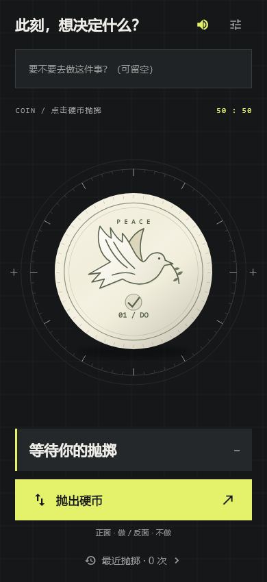
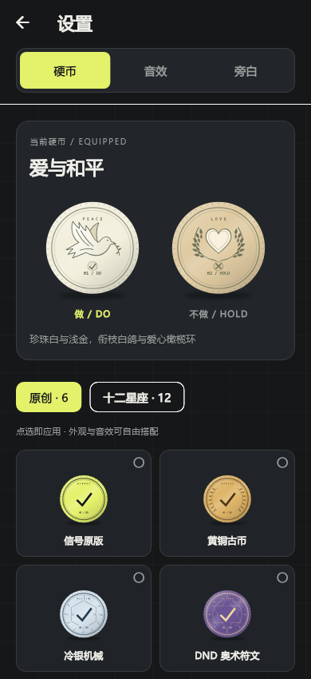

# 二择 · BINARY

**一枚硬币，两种可能。给犹豫一个行动的信号。**

二择是一款简单的抛硬币应用。写下正在犹豫的事情，点击硬币，让它帮你决定「做」还是「不做」。也可以不填写事项，直接抛掷。

## 下载

前往 [Releases 下载页面](https://github.com/DiDaDi-bit/pocket_counter/releases)，在 **Assets** 中下载 `.apk` 安装包，在 Android 手机或模拟器上安装即可。

## 功能

- **18 款硬币**：6 款原创主题，以及完整的十二星座系列。
- **立体抛掷动画**：透视翻转、金属齿边、动态阴影与落地回弹。
- **五种音效**：经典硬币、金属硬币、电子终端、柔和木质、复古街机，可独立试听。
- **多种旁白**：混合、DND、COC 与简洁风格，为结果添一句小提示。
- **本地历史**：保存最近 6 次事项和结果，重启后仍可查看。
- **固定主界面**：适配不同屏幕，抛掷页面不整页滑动。

## 界面预览

  
  &nbsp;&nbsp;
  

## 特别硬币：爱与和平

衔着橄榄枝的白鸽，配上爱心与橄榄枝花环。珍珠白与浅金色，让每一次选择都温柔而坚定。

## 隐私

无需注册账户，核心功能可离线使用。当前应用未接入广告或统计分析服务；设置和最近的事项保存在本地，应用自身不会上传这些内容。

---

遇到问题或有新的想法，欢迎在 [Issues](https://github.com/DiDaDi-bit/pocket_counter/issues) 留言。分享截图时，请注意遮盖自己的事项与个人信息。
